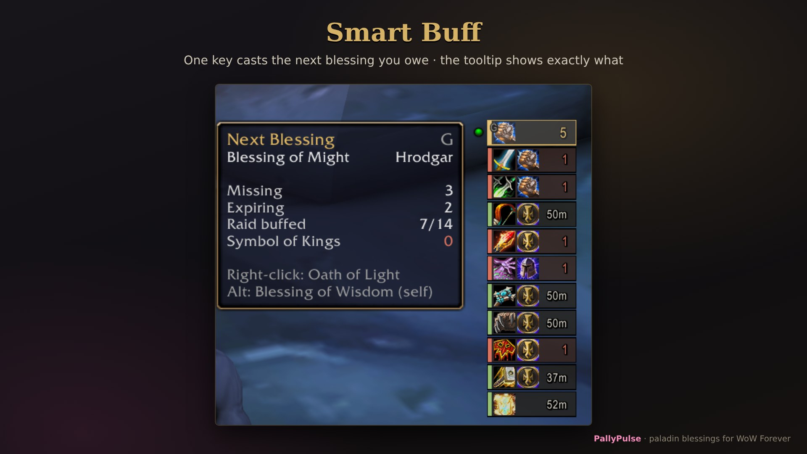
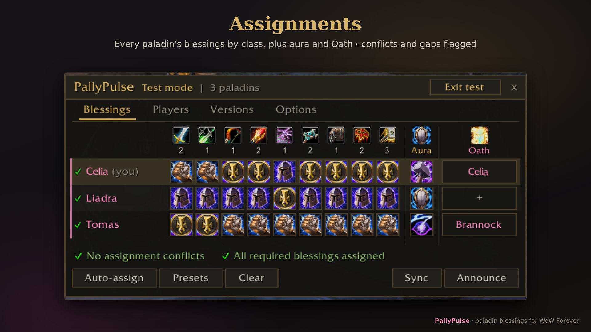

## One key. Less buff management.

PallyPulse handles paladin blessings in WoW Forever. Set your assignments once, bind Smart Buff, and each press casts the next blessing you owe: missing or expiring, Greater or single, on the right player.

Assignments follow each player's spec, Oath of Light goes on your tanks, and the ready check shows exactly what you still owe. It also speaks PallyPower's sync protocol, so the other paladins in your raid don't have to switch addons.

## Quick start

1. Type `/pulse` to open PallyPulse.
2. Go to **Options > General** and bind **Smart Buff**.
3. On the **Blessings** tab, press **Auto-assign** (or load a preset).
4. Press your Smart Buff key again and again until everything is up.

Each press casts one spell. Nothing is cast without you pressing the key or clicking.

## Smart Buff

- One key for your aura, Righteous Fury when you tank, Oath of Light, and every blessing you owe.
- Missing blessings first, then ones about to expire (you choose how early).
- Greater Blessing when enough of a class is in the group, single blessings otherwise.
- Skips players who are dead or out of range. Alt + key blesses yourself.
- The bar's top row and tooltip show what the next press casts, and on whom.

## Assignments that fit the raid

- Auto-assign reads each player's spec, so an Elemental and an Enhancement Shaman each get what they need.
- Give one player a different blessing from their class, by hand or from a `!bless` request in chat.
- Flags assignment conflicts (a player getting the same blessing twice) and blessings nobody covers.
- Save assignments as presets and load them per raid.
- Announce assignments to the group in one click.

## Oath of Light on your tanks

- Holy paladins' Oaths are spread across your tanks, picked from Main Tank markers and the Tank role.
- Its own key binding: mouseover, then target, then yourself.
- Smart Buff recasts it when it drops; an optional sound plays 30 seconds before it runs out.

## Raid readiness

- Opens with every ready check: buffed, missing and unavailable at a glance.
- **Your Responsibilities** on top: who still needs a blessing from you.
- Other paladins' gaps grouped by paladin; click a name to whisper them.
- Dead and offline players are listed apart and never counted as missing.

- The Players tab shows your blessing and the raid's side by side, with what you need to fix first.

## Works with PallyPower

- Sends and reads PallyPower's assignment messages (built against PallyPower Forever 10.10.26).
- Class, per-player and aura assignments stay in sync in a mixed raid.
- Oath of Light assignments only sync between PallyPulse users.

## Light on screen

- A compact bar: Standard rows, icon-only Compact, or Action only (just what you still owe).
- Your blessing and time left on Blizzard's party and raid frames. Click the icon to cast it, in combat too.
- Separate scale for the bar, the window and the ready check; row size, opacity and class names.
- Sound alerts, plus LibSharedMedia sounds and fonts from your other addons.
- Test mode: a fake raid to try everything solo.

## FAQ

**Do I need PallyPower?**
No. PallyPulse works on its own.

**Can I raid with paladins who use PallyPower?**
Yes. With PallyPower sync on (the default), you see their assignments and they see yours.

**Does Smart Buff cast spells by itself?**
No. Each key press casts one spell. PallyPulse only decides which one.

**Does it work in combat?**
Smart Buff works through a list made at the pull. The game hides buffs from addons in combat, so a player who loses a blessing mid-fight (after your Blessing of Protection, say) has to be re-blessed by clicking their name on the bar or their raid frame icon.

**How do I set up Smart Buff?**
Options > General > Key Bindings. Click the Smart Buff button and press a key.

**How is the Oath of Light target chosen?**
From Main Tank markers, then players with the Tank role. With "Auto-assign Oath to tanks" off, set it yourself on the Blessings tab.

**Can I save different assignments?**
Yes. Presets on the Blessings tab.

**Which game versions?**
WoW Forever only.

**Where do I report a bug?**
On GitHub: https://github.com/Vx1125/pallypulse/issues, or in the comments here. `/pulse debug` output helps.

## Chat commands

For anyone in the group, in party, raid or a whisper:

- `!bless want might, kings`: ask for blessings, in order.
- `!bless clear`: back to normal.
- `!bless missing`: your missing blessings. `!bless missing all`: everyone's.
- `!bless report`: which paladin blesses which class.
- Leader or assistant: `!bless assign` runs Auto-assign; `!bless want <name> kings` sets it for someone else.

## Commands

`/pulse` · `/pulse bar` · `/pulse options` · `/pulse check` · `/pulse announce`
