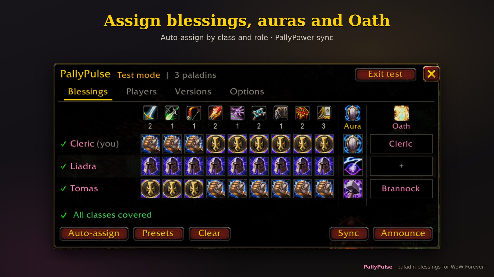
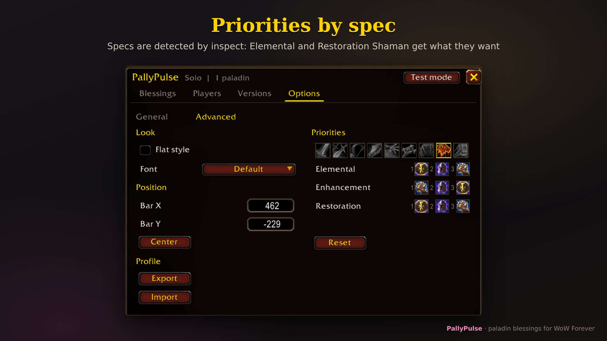
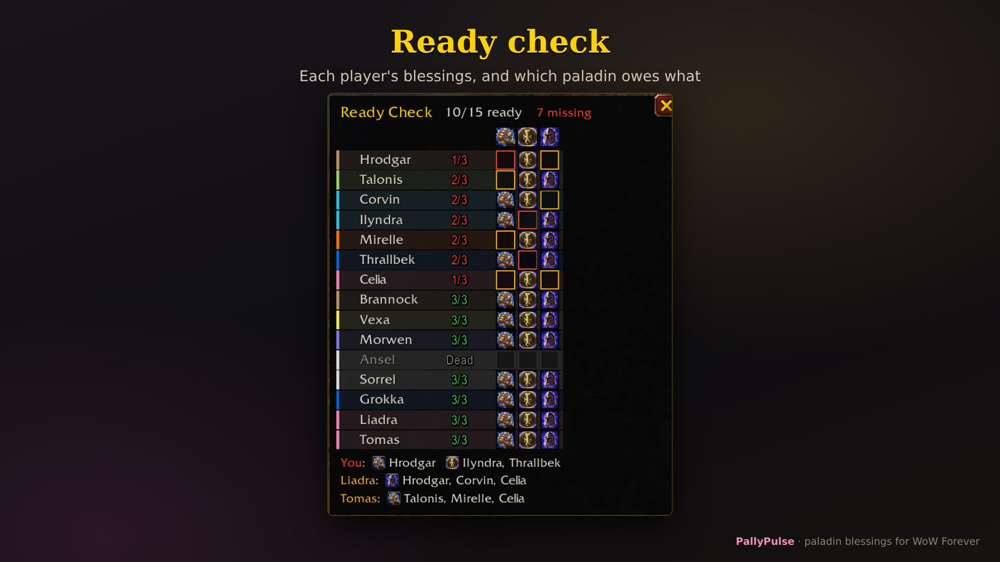
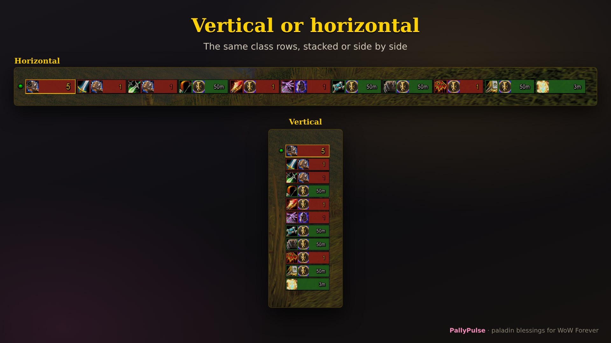
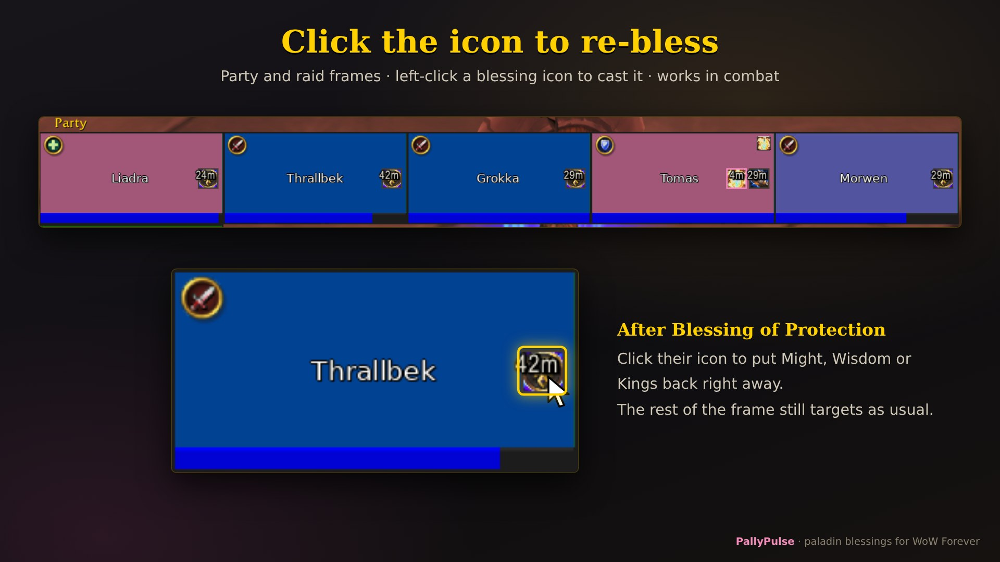
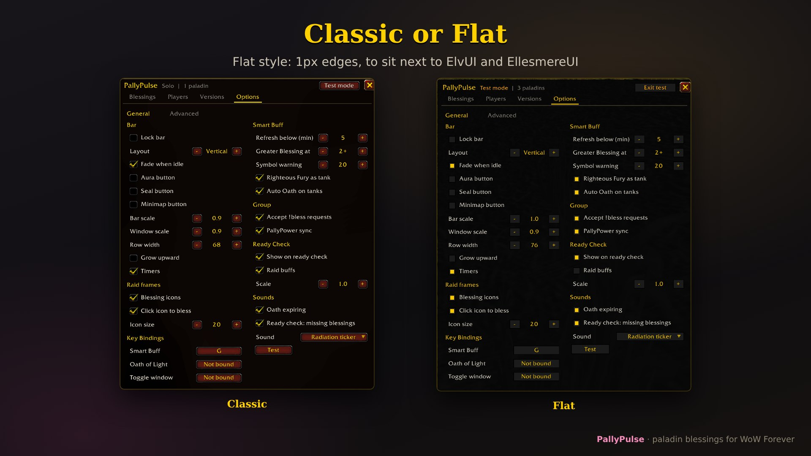

**Paladin blessings for WoW Forever.** Assign once, then press one key to keep the whole raid buffed.

## Smart Buff

- One key casts the next thing you owe: aura, Righteous Fury, Oath of Light, missing or expiring blessings.
- Works in combat, from a list made at the pull: players missing a blessing, then Oath of Light.
- Uses Greater Blessings when enough of a class is in the group.
- Skips players who are out of range or dead.
- Alt + key blesses yourself.
- Warns when Symbols of Kings run low.

**In combat:** the game hides buffs and won't let addons tell which player you're targeting. Smart Buff can't re-bless someone who loses a blessing mid-fight (after your Blessing of Protection, say). Hover their class on the bar and click their name instead.

## Assignments

- Blessings by class, plus aura and Oath of Light for every paladin.
- Auto-assign by spec: each class gets the blessing most of its players want.
- Presets, Announce, and Sync with paladins running PallyPower.
- Each holy paladin's Oath goes on a different tank.
- x2 on the bar when another paladin gives a class the same blessing.

## Per-player blessings

- Give one player a different blessing from the rest of their class, such as Might on an Enhancement Shaman.
- Exceptions are set automatically from spec, or by hand.
- From the bar, hover a class and use the mouse wheel on a player.
- Players without the addon can use chat commands (below).

## Priorities by spec

- Specs are detected by inspect, so an Elemental and a Restoration Shaman each get what they want.
- Set your own blessing order for every class and spec.

## Ready check

- Opens with every ready check and shows each player's blessing count, like 2/3.
- Shows which paladin owes which buff, and who it goes to. Click a name to whisper.
- Optional raid buffs: Fortitude, Mark, Intellect, Spirit, food and flask.

## Bar

- Vertical or horizontal.
- Hover a class to list its players, with range bars; click one to bless just them, in or out of combat.
- Timers on each class, plus aura and seal buttons.
- Can fade when idle.

## Raid frames

- Your blessing on every party and raid frame, with time left. Missing: red, pulsing.
- Click the icon to cast it, in combat too.
- Also shows your hand blessings, Oath of Light and Light's Vigil.

## Classic or Flat

- Flat style: 1px edges and flat panels, to sit next to ElvUI or EllesmereUI.
- Fonts from LibSharedMedia.

## Also

- Key bindings set right in Options.
- Exact bar position, and profiles you can export and import as text.
- Alert sounds, plus any LibSharedMedia sounds from your other addons.
- Test mode: a fake raid to try everything solo.

## Chat commands

For anyone in the group, in party, raid or a whisper:

- `!bless want might, kings`: ask for blessings, in order.
- `!bless clear`: back to normal.
- `!bless missing`: your missing blessings. `!bless missing all`: everyone's.
- `!bless report`: which paladin blesses which class.
- Leader or assistant: `!bless assign` runs Auto-assign; `!bless want <name> kings` sets it for someone else.

## Commands

`/pulse` · `/pulse bar` · `/pulse options` · `/pulse check` · `/pulse announce`
