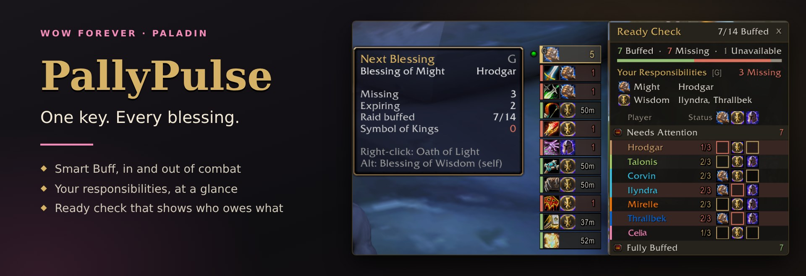
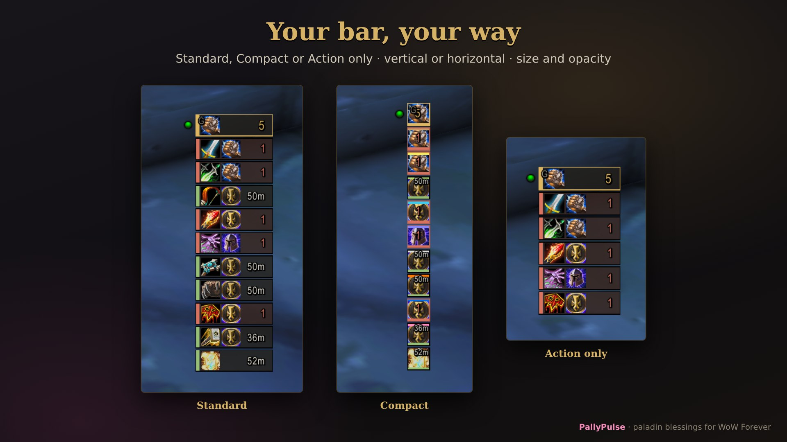
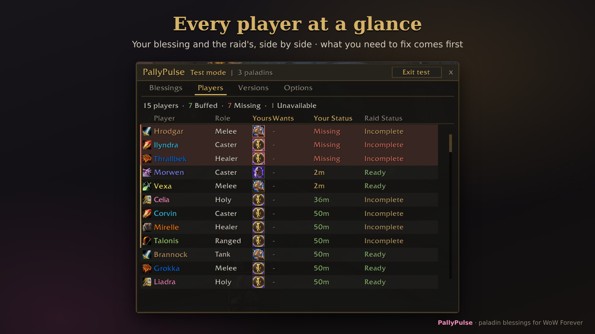
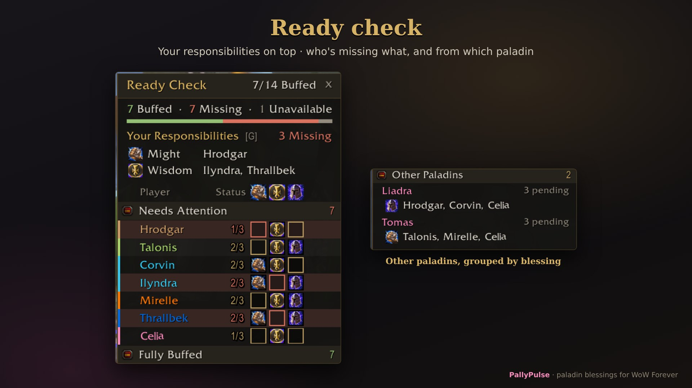
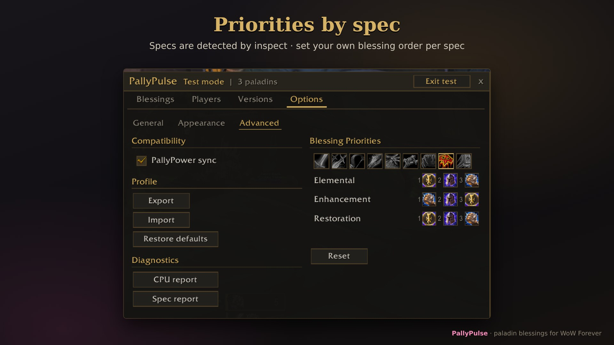
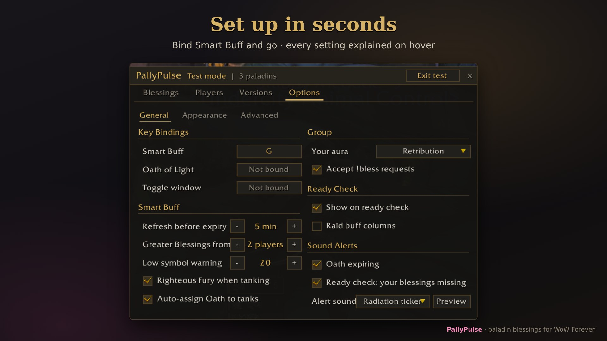

**Paladin blessings for WoW Forever.** Assign once, then press one key to keep the whole raid buffed.

## Smart Buff

- One key casts the next thing you owe: aura, Righteous Fury, Oath of Light, missing or expiring blessings.
- The bar's top row and its tooltip show what the next press will cast, and on whom.
- Works in combat, from a list made at the pull: players missing a blessing, then Oath of Light.
- Uses Greater Blessings when enough of a class is in the group.
- Skips players who are out of range or dead. Alt + key blesses yourself.
- Warns when Symbols of Kings run low.

**In combat:** the game hides buffs and won't let addons tell which player you're targeting. Smart Buff can't re-bless someone who loses a blessing mid-fight (after your Blessing of Protection, say). Hover their class on the bar and click their name, or click their raid frame icon.

## Your bar, your way

- Standard rows, Compact icons, or Action only: just the classes you still owe.
- Vertical or horizontal, with row height, icon size, opacity and optional class names.
- A thin status strip on each row: green active, gold expiring, red missing.
- Hover a class to list its players, with range bars; click one to bless just them, in or out of combat.

## Assignments

- Blessings by class, plus aura and Oath of Light for every paladin.
- Auto-assign by spec: each class gets the blessing most of its players want.
- Conflicts (a player getting the same blessing twice) and unassigned blessings are flagged; hover for the details.
- Presets, Announce, and Sync with paladins running PallyPower.
- Each holy paladin's Oath goes on a different tank.

## Every player at a glance

- Your blessing and the raid's in separate columns, so you can tell what's yours to fix.
- Players missing your blessing come first, then yours expiring.
- Give one player a different blessing from the rest of their class, such as Might on an Enhancement Shaman. Set automatically from spec, or by hand.

## Ready check

- Opens with every ready check: buffed, missing and unavailable at a glance.
- Your Responsibilities on top: who still needs a blessing from you, with your Smart Buff key.
- Needs Attention, Fully Buffed, Unavailable and Other Paladins, each folding open or shut.
- Click another paladin's name to whisper them what they owe.
- Optional raid buff columns: Fortitude, Mark, Intellect, Spirit, food and flask.

## Raid frames

- Your blessing on every party and raid frame, with time left. Missing: red, pulsing.
- Click the icon to cast it, in combat too.
- Also shows your hand blessings and Oath of Light.

## Priorities by spec

- Specs are detected by inspect, so an Elemental and a Restoration Shaman each get what they want.
- Set your own blessing order for every class and spec.

## Options

- Bind Smart Buff right in Options and go; every setting explains itself on hover.
- General, Appearance and Advanced pages, with separate scales for the bar, window and ready check.
- Profiles you can export and import as text, and Restore defaults.
- Alert sounds, plus any LibSharedMedia sounds and fonts from your other addons.
- Test mode: a fake raid to try everything solo.

## Chat commands

For anyone in the group, in party, raid or a whisper:

- `!bless want might, kings`: ask for blessings, in order.
- `!bless clear`: back to normal.
- `!bless missing`: your missing blessings. `!bless missing all`: everyone's.
- `!bless report`: which paladin blesses which class.
- Leader or assistant: `!bless assign` runs Auto-assign; `!bless want <name> kings` sets it for someone else.

## Commands

`/pulse` · `/pulse bar` · `/pulse options` · `/pulse check` · `/pulse announce`
